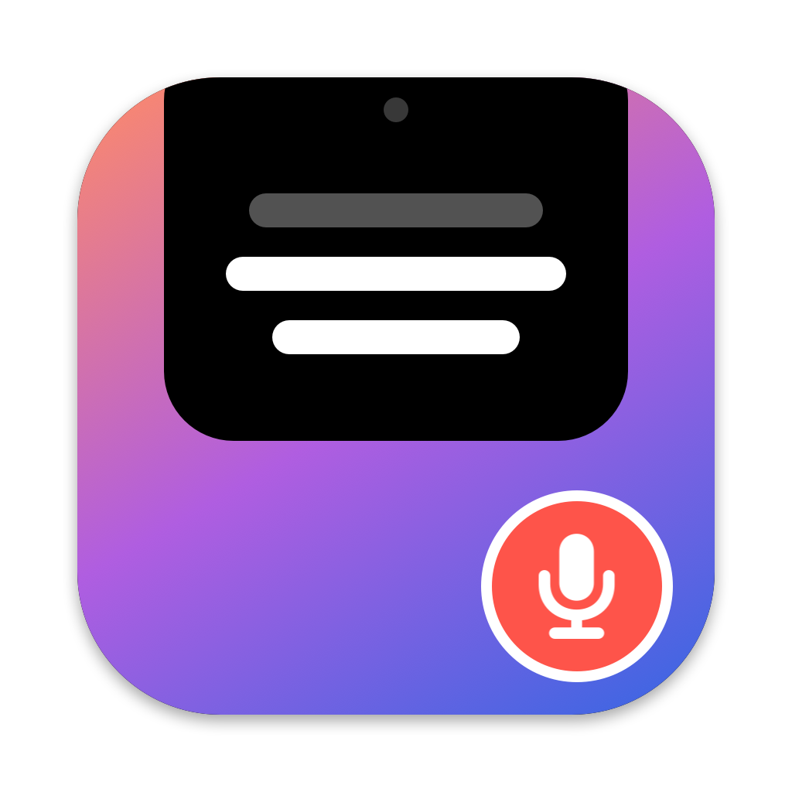
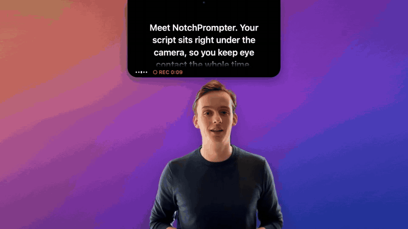
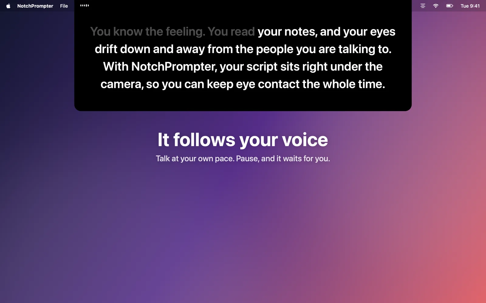
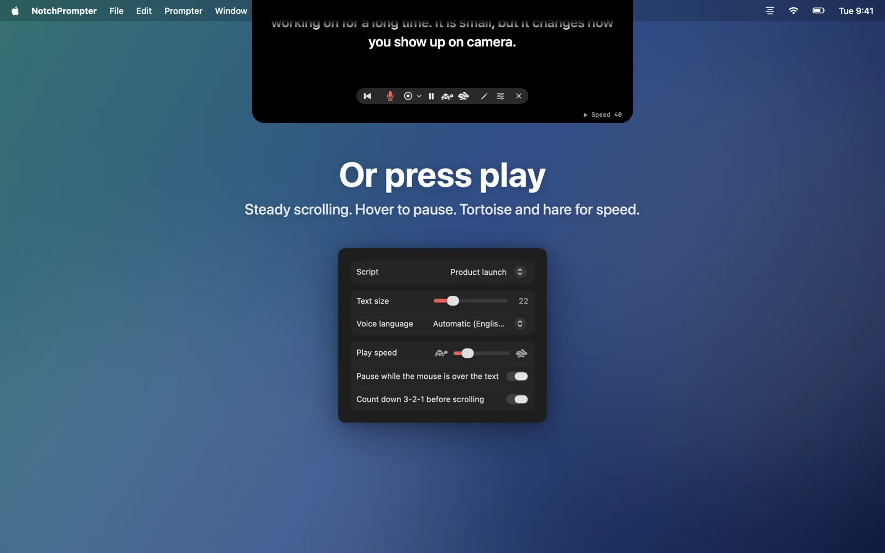
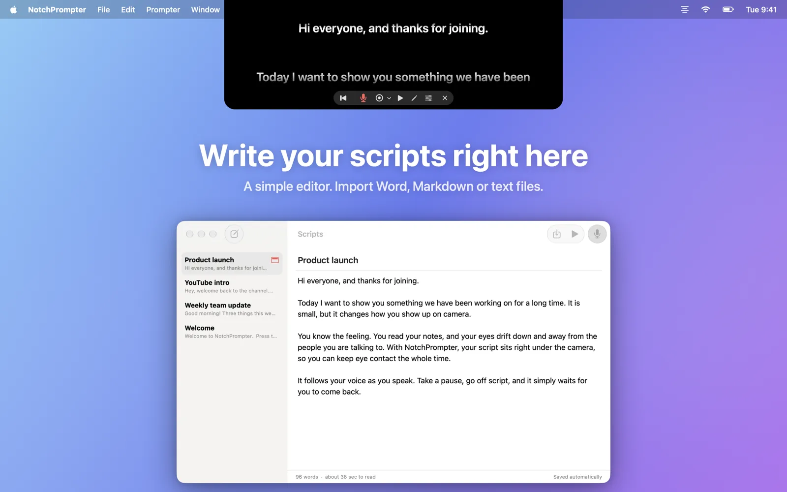
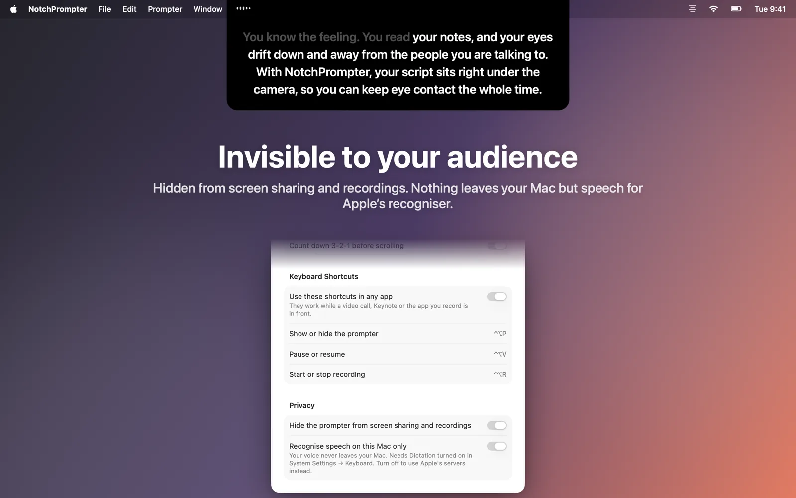

<div align="center">
  
  <h1>NotchPrompter</h1>
  <p><b>A free teleprompter for the Mac that sits right under your camera and follows your voice.</b><br>
  Read your script and keep eye contact.</p>

  <a href="https://apps.apple.com/app/notchprompter/id6815206814"></a>
  <a href="https://magnram.github.io/notchprompter/"></a>
  <br>
  
  
  
  <a href="LICENSE"></a>
</div>

<br>

<p align="center">
  <a href="https://magnram.github.io/notchprompter/media/promo.mp4"></a>
  <br>
  <sub><a href="https://magnram.github.io/notchprompter/media/promo.mp4">▶ Watch the full video with sound (51 s)</a></sub>
</p>

When you read from notes, your eyes drift down, away from the people you talk to.
NotchPrompter puts your script in a small black panel that hangs from the top of your screen,
right under the camera. On a MacBook with a notch, it blends into the notch.
Press the microphone and talk: the text follows you, so the next words are always where you look.

## Features

**Reading**

- 🎙️ **Follows your voice.** The text moves as you read. Words you have said fade out.
- 🌍 **Any language.** It sees which language your script is in and listens for it.
- ⏭️ **Keeps up when you go off script.** Skip a sentence and it finds your place. Say "uh", or a sentence again, and it stays put. Pause, and it waits.
- ▶️ **Or press play.** Smooth scrolling with a 3-2-1 countdown and speed controls.
- 🖥️ **On the screen with the camera.** It picks the screen with the notch, or you choose another screen in Settings.

**Your scripts**

- ✍️ **Built-in editor.** Import Word, Markdown, RTF, HTML or text. Notes in (parentheses) or [brackets] are shown, but not read out.
- 📁 **Scripts as files.** Keep your scripts as Markdown files in a folder. Edit them in any app, or let an AI assistant write them. [How it works](#scripts-as-files).
- ☁️ **Sync through your own iCloud.** Your scripts are the same on your Macs and in the iPhone app.

**Recording**

- 🎬 **Record yourself.** Film your camera, your screen, or both, while the script follows your voice. A small preview shows how you look. Takes go to Movies › NotchPrompter.
- 💬 **Subtitles with each take.** An .srt file next to the movie, made on your Mac after the take.
- 💡 **Screen light.** During a take, the rest of the screen can turn a soft, warm white to light your face, or black to stop glare in glasses.
- ⌨️ **Shortcuts in any app.** Show the prompter, pause and record while a video call or Keynote is in front.

**Privacy**

- 🙈 **Invisible to your audience.** Hidden from screen sharing, screenshots and recordings.
- 🔒 **Runs on your Mac.** Speech is recognised on the Mac. No account, no tracking. The microphone and camera are only on while you use them.

<table>
  <tr>
    <td width="50%"></td>
    <td width="50%"></td>
  </tr>
  <tr>
    <td align="center"><sub>It follows your voice</sub></td>
    <td align="center"><sub>Or scroll at a steady pace</sub></td>
  </tr>
  <tr>
    <td width="50%"></td>
    <td width="50%"></td>
  </tr>
  <tr>
    <td align="center"><sub>Write or import your script</sub></td>
    <td align="center"><sub>Hidden from screen sharing</sub></td>
  </tr>
</table>

## Get started

1. Get NotchPrompter from the [Mac App Store](https://apps.apple.com/app/notchprompter/id6815206814), or [build it yourself](#build-from-source).
2. Open it and allow the microphone and speech recognition. The welcome guide shows you how.
3. Click **Try It Now** and read the practice script out loud.

NotchPrompter needs macOS 15 Sequoia or later. It works best on a MacBook with a notch,
and on any Mac with a camera on top of the screen.

## Scripts as files

In Settings, turn on **Keep scripts as files in a folder** and pick a folder. Each script becomes one
Markdown file: the file name is the title, and the file is the text.

```
Scripts/
├── Product launch.md
├── Weekly team update.md
└── YouTube intro.md
```

It works both ways. Edit, add, rename or delete a file, and the script in NotchPrompter changes right away.
Change a script in NotchPrompter, and the file changes. So any text editor can open your scripts, and an
AI assistant such as Claude Code or Codex can write or tighten a script for you.

Turn on **Save a transcript with each take** to get subtitles (.srt) next to every movie. Use them for
captions, or give the transcript to an AI assistant to check the take or find where to cut.

## On iPhone

There is also **NotchPrompter for iPhone**. It puts your script right under the front camera,
follows your voice and films you, and every take goes to your Photos.

It is free to use: the prompter, voice-follow, recording, trimming and captions are free, with no
watermark. NotchPrompter Pro adds 4K, music, voiceover, Cut Pauses and more editing tools, by the
month, by the year or with one payment.

The iPhone app is **not open source**. It uses the same voice engine as the Mac app,
[NotchPrompterKit](NotchPrompterKit), which is in this repository under the MIT license.
It is coming soon to the App Store.

## Keyboard shortcuts

When the prompter has focus (click it first):

| Key | Action |
|---|---|
| <kbd>V</kbd> | Follow my voice, on or off |
| <kbd>Space</kbd> | Play or pause |
| <kbd>C</kbd> | Record, or stop recording |
| <kbd>R</kbd> | Back to the top |
| <kbd>E</kbd> | Open the script editor |
| <kbd>↑</kbd> <kbd>↓</kbd> | Faster, slower |
| <kbd>+</kbd> <kbd>−</kbd> | Bigger, smaller text |
| <kbd>←</kbd> <kbd>→</kbd> | Narrower, wider prompter |
| <kbd>⇧</kbd> <kbd>↑</kbd> <kbd>↓</kbd> | Shorter, taller prompter |
| <kbd>H</kbd> | Pause when the mouse is over the prompter, on or off |
| <kbd>⌘</kbd> <kbd>⌫</kbd> | Move the last take to the Trash |
| <kbd>⌘</kbd> <kbd>,</kbd> | Settings |
| <kbd>Esc</kbd> | Stop |

In any app, also while a video call or Keynote is in front:

| Key | Action |
|---|---|
| <kbd>⌃</kbd> <kbd>⌥</kbd> <kbd>P</kbd> | Show or hide the prompter |
| <kbd>⌃</kbd> <kbd>⌥</kbd> <kbd>V</kbd> | Pause or resume |
| <kbd>⌃</kbd> <kbd>⌥</kbd> <kbd>R</kbd> | Start or stop recording |

You can turn these off in Settings → Keyboard Shortcuts. The Prompter menu has its own shortcuts too:
<kbd>⇧</kbd><kbd>⌘</kbd><kbd>P</kbd> shows the prompter, <kbd>⇧</kbd><kbd>⌘</kbd><kbd>V</kbd> follows your voice,
<kbd>⌥</kbd><kbd>⌘</kbd><kbd>R</kbd> records and <kbd>⇧</kbd><kbd>⌘</kbd><kbd>R</kbd> goes back to the top.
Click a word in the prompter to continue from there.

## Privacy

- Speech recognition runs on your Mac. It needs Dictation turned on in System Settings.
  You can allow Apple's servers in Settings → Privacy for languages the Mac can't do by itself.
- Scripts stay on your Mac. If you use iCloud, they are also saved in your own iCloud account, so they sync with the iPhone app.
  Recordings, and the subtitles made from them, stay on your Mac. There is no account, no analytics and no network code of our own.
- The prompter is hidden from screen sharing, screenshots and screen recordings. You can turn this off in Settings → Privacy.

## FAQ

<details>
<summary><b>Do I need a MacBook with a notch?</b></summary>
<br>
No. On a Mac without a notch, the prompter hangs from the top of the screen, under the camera, in the same way.
</details>

<details>
<summary><b>Which languages does voice-follow understand?</b></summary>
<br>
Every language that Apple's speech recognition supports on your Mac: English, Norwegian, German, Spanish,
Japanese and dozens more. NotchPrompter picks the language from your script. You can also choose it in Settings.
</details>

<details>
<summary><b>Why can't the people in my call see the prompter?</b></summary>
<br>
That's on purpose: the prompter window is left out of screen sharing, screenshots and recordings.
Turn it off in Settings → Privacy if you want to show it.
</details>

<details>
<summary><b>The text doesn't move when I talk.</b></summary>
<br>
Check that NotchPrompter can use the microphone and speech recognition in System Settings → Privacy &amp; Security,
and that Dictation is on (System Settings → Keyboard). The microphone button in the prompter must be on.
</details>

<details>
<summary><b>How does voice-follow work?</b></summary>
<br>
Apple's speech recogniser streams the words it hears. <code>VoiceMatcher</code> (in
<a href="NotchPrompterKit/Sources/NotchPrompterKit/VoiceMatcher.swift"><code>VoiceMatcher.swift</code></a>) lines up the last few heard words with the script.
A word or two ahead is easy to reach. A bigger jump needs several words in a row that fit, and words that come up
all over the script count less than rare ones. It never jumps back on its own, and it stays put when you say
a part again. The tests are in <code>Tools/MatcherTests</code> (run <code>Tools/test-matcher.sh</code>).
</details>

## Build from source

Open `NotchPrompter.xcodeproj` in Xcode 16 or later and run, or from the terminal:

```sh
./build.sh && open NotchPrompter.app
```

To sign with your own team, change `DEVELOPMENT_TEAM` in the project settings.

No Apple developer account? `build.sh` notices when the Mac has no signing certificate and builds
the app for this Mac only (`./build.sh --local` does the same on purpose). Everything works except
iCloud sync, which needs the project's team. macOS can ask again for camera, microphone and screen
recording access after each such build. If screen recording stops working, remove NotchPrompter from
System Settings → Privacy & Security → Screen & System Audio Recording and add it again.

## Translations

The app, the website and the App Store page are in 20 languages: English, Norwegian, German, French, Spanish,
Italian, Portuguese (Brazil and Portugal), Dutch, Swedish, Danish, Finnish, Polish, Japanese, Korean,
Chinese (Simplified and Traditional), Russian, Ukrainian and Turkish.

Native speakers have not checked the translations yet. If a word is wrong in your language, please
[open an issue](https://github.com/magnram/notchprompter/issues) or send a pull request.

| What | Where | How to update |
|---|---|---|
| App text | `NotchPrompter/Localizable.xcstrings`, `InfoPlist.xcstrings`, and the voice engine's messages in `NotchPrompterKit/Sources/NotchPrompterKit/Localizable.xcstrings` | Edit in Xcode's string catalog editor |
| Website | `website/i18n/<lang>.json` | Run `python3 website/i18n/build.py`, then commit the pages it writes. See [website/i18n/README.md](website/i18n/README.md) |
| App Store text | `fastlane/metadata/<locale>/` | Check the length limits with `python3 fastlane/check_metadata.py` |
| Screenshots | `NotchPrompter/ScreenshotContent.swift` | Run `Tools/render-all-languages.sh` (or give it languages, e.g. `de ja`) |

<details>
<summary><b>Release and project layout</b> (for maintainers)</summary>

### Release

The App Store release uses [fastlane](https://fastlane.tools) with an App Store Connect API key
(`ASC_KEY_ID`, `ASC_ISSUER_ID` and `ASC_KEY_PATH` in the environment).

```sh
fastlane mac status                   # show the versions and builds; changes nothing
fastlane mac release version:1.1      # build, upload the package, text and screenshots
fastlane mac metadata version:1.1     # only the text and screenshots
fastlane mac submit_review            # submit for review, with manual release
```

The version is required, so text for a new version never lands in one that is already in review.

### Project layout

| Folder | What's in it |
|---|---|
| `NotchPrompter/` | The app (AppKit + SwiftUI) |
| `NotchPrompterKit/` | Swift package for macOS and iOS: the voice engine (`VoiceMatcher`, `VoiceListener`), stage directions, script storage and settings. The Mac app and the iPhone app both use it |
| `Config/` | Entitlements and Info.plist |
| `Tools/` | Icon generator, screenshot rendering and matcher tests (`Tools/test-matcher.sh`) |
| `website/` | The website, published to GitHub Pages by `.github/workflows/pages.yml` |
| `AppStore/` | App Store listing notes, English screenshots and the submission checklist |
| `fastlane/` | Release lanes, and the App Store text and screenshots for every language |
| `video/` | The promo videos (landscape and TikTok), made with HyperFrames |

</details>

## Contributing

Bug reports and ideas are welcome in [Issues](https://github.com/magnram/notchprompter/issues). Pull requests too.

## License

[MIT](LICENSE)
